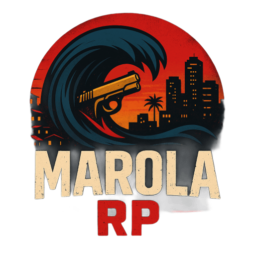
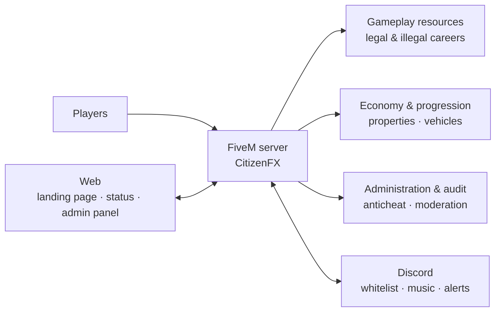

# Marola RP

### Architecture and roadmap of a Brazilian FiveM roleplay community

The public face of the Marola RP project: what the server is, how its ecosystem is organized and the plan
that guides its evolution. The production server code lives in private repositories.

---

## Table of Contents

- [Overview](#overview)
- [Ecosystem](#ecosystem)
- [Roadmap](#roadmap)
- [Repository structure](#repository-structure)
- [Security and disclosure](#security-and-disclosure)
- [Current status](#current-status)

---

## Overview

**Marola RP** is a Brazilian FiveM roleplay server focused on community, structured operations and immersive
gameplay. This repository is intentionally small: it documents the direction of the project without publishing
production configuration, licensed assets, credentials or abuse-sensitive systems.

It is built for:

- players and staff who want to understand how the project is organized;
- collaborators evaluating the roadmap before joining;
- other community admins looking at how a roleplay server can be run like a product.

---

## Ecosystem

| Pillar | What it covers |
|---|---|
| **Identity** | Brazilian roleplay culture and community events |
| **Careers** | Legal and illegal jobs with their own progression |
| **Economy** | Money, properties, vehicles and seasonal content |
| **Operations** | Administration, moderation, audit trails and anticheat |
| **Integrations** | Discord whitelist, music bot, alerts and a public status page |

---

## Roadmap

The action plan in [`PLANO_DE_ACAO.md`](PLANO_DE_ACAO.md) (Portuguese) runs in six stages:

| Stage | Focus |
|---|---|
| 1 | Organization and structure |
| 2 | Technical audit |
| 3 | Player experience |
| 4 | Documentation and support |
| 5 | Versioning and deploy |
| 6 | Monitoring and continuous evolution |

---

## Repository structure

| Path | What it is |
|---|---|
| `README.md` | This overview |
| `PLANO_DE_ACAO.md` | Six-stage action plan with a tracking template |
| `logoMa.png` | Project identity |
| `LICENSE` | Proprietary license |

Related public repos: [md](https://github.com/Samurai33/md) (documentation) ·
[Marola-Beat](https://github.com/Samurai33/Marola-Beat) (music bot).

---

## Security and disclosure

Do not publish exploits, player data, credentials or production configuration. Report security issues
privately through the contact channels on [marolaroleplay.com.br](https://marolaroleplay.com.br).

---

## Current status

| | |
|---|---|
| **Server** | Running for the community |
| **This repository** | Overview and roadmap only |
| **Source code** | Private |

---

**Need something built, secured or kept online?** → [samurai@n3xus.dev](mailto:samurai@n3xus.dev) · [n3xus.dev](https://n3xus.dev)

© Thiago "Samurai" Rangel · [N3XUS](https://n3xus.dev) · Proprietary license

